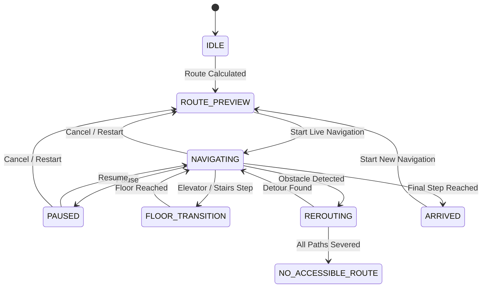

# PHASE 15 — REAL-TIME INDOOR & OUTDOOR WAYFINDING SYSTEM
## Accessible Campus Navigator — JAIN Global Campus 3D Digital Twin
### Comprehensive Engineering, Verification & Validation Report

---

## 1. Executive Summary & Phase Objectives

Phase 15 transforms the **Accessible Campus Navigator** from a static 3D visual twin into a stateful, interactive, real-time indoor and outdoor wayfinding system. Building directly upon the foundation established in Phases 12–14 (the 300-acre JAIN Global Campus outdoor reconstruction, the 5-floor FET architectural model, the 79-location / 106-pathway graph, NetworkX routing, and SQLite obstacle synchronization), Phase 15 introduces dynamic session tracking, turn-by-turn guidance, live 3D user avatar positioning, automatic obstacle detection and detour recalculation, and wheelchair accessibility safeguards.

### Key Achievements
1. **Stateful Navigation Controller (`NavigationSession`):** A robust finite-state machine governing the complete wayfinding lifecycle (`IDLE`, `ROUTE_PREVIEW`, `NAVIGATING`, `PAUSED`, `FLOOR_TRANSITION`, `ARRIVED`, `REROUTING`, `NO_ACCESSIBLE_ROUTE`).
2. **Turn-by-Turn Instruction Generator (`NavigationInstruction`):** Rigorous 2D geometric vector turn angle approximations ($u \times v$ cross product and $u \cdot v$ dot product) generating precise navigational cues (`continue straight`, `turn left`, `turn right`, `turn around`, `enter_building`, `exit_building`, `elevator`, `stairs`, `ramp`, `arrive`) with landmark references and clear disclosures.
3. **Live 3D Route Progress & Avatar Marker:** Real-time Three.js visualization featuring a dedicated user avatar (pulsing ground ring, directional cone pointer, glowing orb, point light), segmented route tubes (completed vs active vs remaining), vertical elevator cab synchronization, and arrival celebration effects.
4. **Interactive Streamlit Live Navigation Dashboard:** Real-time metrics HUD including progress percentage, remaining distance, estimated arrival time (ETA), active and next step cards, floor indicators, and responsive controls (Start, Pause, Resume, Next Step, Restart, Cancel).
5. **Dynamic Obstacle Detection & Automatic Rerouting:** Real-time synchronization with verified SQLite hazards; upcoming obstacles trigger automatic route recalculations from the user's current node while preserving destination and wheelchair mode.
6. **Strict Wheelchair Mode Guarantee:** Continuous enforcement of step-free routes, mandatory avoidance of all 18 staircase edges, priority routing via ramps and elevators, and clear accessibility disclosures.
7. **Comprehensive Test Suite & Zero Regressions:** 10 new comprehensive unit/integration tests in `tests/test_real_time_wayfinding.py`, bringing the total project test suite to **131 tests passing with 0 failures and 0 errors**.

---

## 2. System Architecture & Component Design

```
+-----------------------------------------------------------------------------------+
|                           STREAMLIT UI LAYER                                      |
|  - pages/3d_campus_map.py (Dashboard Banner, HUD, Action Buttons, Step Expander)  |
|  - Session State Persistence (st.session_state["nav_session"])                    |
+-----------------------------------------------------------------------------------+
                                  |
                                  v
+-----------------------------------------------------------------------------------+
|                         WAYFINDING CORE CONTROLLER                                |
|  modules/navigation_session.py:                                                   |
|    - NavigationSession State Machine                                              |
|    - Progress & Distance Tracking                                                 |
|    - Dynamic Obstacle Detour Engine                                               |
|  modules/navigation_instructions.py:                                              |
|    - Geometric Turn Angle Computation (Cross & Dot Vector Products)               |
|    - Turn-by-Turn Instruction Taxonomy & Action Types                             |
|    - Landmark & Floor Level Formatting                                            |
+-----------------------------------------------------------------------------------+
          |                                                 |
          v                                                 v
+------------------------------------+   +------------------------------------------+
|       PYTHON ROUTING BACKEND       |   |          THREE.JS 3D ENGINE              |
|  modules/route_finder.py           |   |  modules/jain_digital_twin.py            |
|  modules/campus_map.py             |   |  - Avatar Navigation Marker              |
|  modules/accessibility.py          |   |  - Segmented Route Spline Tube           |
|  database/db_manager.py (SQLite)   |   |  - Dynamic Elevator Cab Sync             |
|  modules/obstacle_manager.py       |   |  - In-Canvas Floating HUD Card           |
+------------------------------------+   +------------------------------------------+
```

### 2.1 Navigation Session State Machine (`modules/navigation_session.py`)

The `NavigationSession` class manages the state and progression of a user's journey through the campus.

#### State Definitions
- `IDLE`: No active route or destination selected.
- `ROUTE_PREVIEW`: Route calculated and displayed; user reviewing metrics before departure.
- `NAVIGATING`: Active journey in progress; avatar advances step-by-step.
- `PAUSED`: Navigation temporarily held by the user; position and elapsed metrics preserved.
- `FLOOR_TRANSITION`: User currently transitioning vertically via elevator or stairs between building floors.
- `ARRIVED`: Final destination node reached; journey summary and celebration displayed.
- `REROUTING`: An active obstacle was detected along the remaining path; route is dynamically recalculating.
- `NO_ACCESSIBLE_ROUTE`: The remaining route or destination is blocked with no passable alternative.

#### State Transitions


### 2.2 Turn-by-Turn Instruction Generator (`modules/navigation_instructions.py`)

The turn-by-turn guidance engine translates graph path nodes $(p_0, p_1, \dots, p_n)$ into actionable, human-readable navigation instructions.

#### Geometric Turn Angle Computation
Turn angles are computed by inspecting consecutive directional 2D vectors $\vec{u} = p_{i} - p_{i-1}$ and $\vec{v} = p_{i+1} - p_{i}$ in the campus coordinate plane ($+X$ East, $+Z$ South):
$$\text{Cross Product: } C = u_x v_z - u_z v_x$$
$$\text{Dot Product: } D = u_x v_x + u_z v_z$$
$$\theta = \text{atan2}(C, D) \times \frac{180}{\pi}$$

- **Continue Straight:** $-25^\circ \le \theta \le +25^\circ$
- **Turn Slight Right:** $+25^\circ < \theta \le +60^\circ$
- **Turn Right:** $+60^\circ < \theta \le +120^\circ$
- **Turn Sharp Right:** $+120^\circ < \theta < +155^\circ$
- **Turn Slight Left:** $-60^\circ \le \theta < -25^\circ$
- **Turn Left:** $-120^\circ \le \theta < -60^\circ$
- **Turn Sharp Left:** $-155^\circ < \theta < -120^\circ$
- **Turn Around / U-Turn:** $|\theta| \ge 155^\circ$

#### Action Taxonomy
Each instruction assigns an explicit `action_type`:
- `enter_building`: Moving from outdoor ground (floor -1) into the building (floor 0).
- `exit_building`: Moving from indoor ground (floor 0) to outdoor grounds (floor -1).
- `elevator`: Vertical level transition via elevator core (`"Take elevator from Floor A to Floor B"`).
- `stairs`: Vertical transition via stairwell (`"Take stairs to Floor B"`).
- `ramp`: Movement along accessible entrance or corridor ramps.
- `turn_left`, `turn_right`, `continue_straight`, `turn_around`: Planar directional guidance.
- `arrive`: Destination arrival confirmation.

#### Data Accuracy & Simulation Disclosure
> [!NOTE]
> **Simulation and Geometric Approximation Notice:**
> The turn directions provided by this system are calculated based on mathematical graph layout coordinates and vector angles. They are geometric approximations designed to assist orientation within the 3D campus twin. This system does not access physical live GPS or magnetometer hardware; position updates are simulated via step-by-step progress tracking.

---

## 3. 3D WebGL Visualization & Avatar Engine

The Three.js scene generation in `modules/jain_digital_twin.py` was extended to visualize real-time navigational progress directly in WebGL.

### 3.1 User Avatar Navigation Marker
An animated, multi-part avatar marker is rendered at the user's active coordinate $(X, Y, Z)$:
- **Pulsing Ground Ring:** A horizontal `RingGeometry(1.2, 1.8, 32)` positioned slightly above the floor slab ($Y + 0.15$), with pulsating scale and opacity using sinusoidal animation ($\sin(t \times 4)$).
- **Directional Pointer Cone:** A `ConeGeometry(0.8, 2.0, 16)` pointing along the bearing vector toward the next waypoint.
- **Glowing Position Orb:** A central `SphereGeometry(0.7, 16, 16)` with emissive glow (`#35D99A`).
- **Local Point Light:** A dedicated `PointLight(0x35D99A, 1.5, 12)` illuminating surrounding floor tiles and walls.

### 3.2 Segmented Route Spline Tube
The route trajectory tube dynamically adapts to reflect journey completion:
- **Completed Segments:** Rendered with muted translucent teal material (`opacity: 0.35`, `#16A36A`).
- **Active Segment:** Rendered with bright, high-emissive green glow (`#35D99A`).
- **Remaining Segments:** Rendered with standard golden/amber routing line (`#F5B942`).

### 3.3 Dynamic Vertical Elevator Cab Synchronization
During multi-floor elevator transit (`FLOOR_TRANSITION` state), the 3D elevator cab geometry is smoothly interpolated along the vertical $Y$-axis between the source floor height ($Y_{\text{src}} = \text{floor}_1 \times 12.0$) and the destination floor height ($Y_{\text{dest}} = \text{floor}_2 \times 12.0$), visually demonstrating the vertical transition in real time.

### 3.4 In-Canvas Floating Navigation HUD (`#nav-live-card`)
An interactive, glassmorphic HUD card floats in the upper corner of the WebGL canvas:
- Current instruction icon and text.
- Step progress counter (`Step X of Y`).
- Next step preview.
- Canvas-embedded interactive navigation buttons (`⏮️ Previous`, `⏯️ Pause/Resume`, `⏭️ Next Step`, `🔄 Restart`).

---

## 4. Dynamic Obstacle Detection & Automatic Rerouting

The navigation engine continuously cross-checks active SQLite obstacle reports against the user's remaining route segments:

```
[User Navigating at Node N_k]
          |
          v
[Scan Remaining Path: (N_k, N_{k+1}, ..., N_{dest})]
          |
          +---> Any segment marked "Verified" in SQLite?
                   |
                  NO ---> Continue NAVIGATING
                   |
                  YES
                   |
                   v
          [Trigger REROUTING State]
          [Log Reroute Notice & Cause]
          [Invoke RouteFinder.find_route(current_node=N_k, destination=N_dest, mode=wheelchair)]
                   |
                   +---> Alternative Route Found?
                            |
                           YES ---> Update Path & Resume NAVIGATING
                            |
                            NO  ---> Transition to NO_ACCESSIBLE_ROUTE
```

### Safety & Concurrency Guarantees
1. **Preservation of Origin & State:** The rerouting calculation originates from `current_node` (where the user is physically located), preserving the original destination and accessibility settings.
2. **Wheelchair Mode Invariance:** If the initial session was configured with `wheelchair_mode=True`, the recalculated detour strictly maintains wheelchair constraints (never falling back to stairs).
3. **Multi-Hazard Resilience:** If multiple obstacles occur on candidate detours, the NetworkX pathfinder safely avoids all verified hazard edges.
4. **Graceful Fallback:** If all connecting vertical or horizontal pathways are severed, the engine gracefully enters `NO_ACCESSIBLE_ROUTE` and warns the user without crashing.

---

## 5. Verification & Test Suite Results

A dedicated automated test suite was developed in `tests/test_real_time_wayfinding.py`. It comprises 10 comprehensive unit and integration tests validating the entire wayfinding lifecycle:

| Test Case | Method | Description | Status |
|:---|:---|:---|:---:|
| 1 | `test_session_initialization_and_lifecycle` | Validates session start, step progression, pause, resume, restart, and state boundaries | **PASS** |
| 2 | `test_invalid_state_transitions_rejected` | Confirms illegal actions (e.g. stepping an idle session or starting without a route) raise `ValueError` | **PASS** |
| 3 | `test_turn_by_turn_instructions_generation` | Verifies planar turns, elevator actions, entrance/exit actions, and arrival steps | **PASS** |
| 4 | `test_turn_angle_geometry` | Mathematically validates vector cross/dot product calculations for all 8 angular quadrants | **PASS** |
| 5 | `test_navigation_progress_metrics` | Verifies distance remaining, time remaining, percentage, and step count calculations | **PASS** |
| 6 | `test_automatic_obstacle_detection_and_rerouting` | Tests dynamic detection of verified SQLite obstacles and successful detour calculation | **PASS** |
| 7 | `test_wheelchair_mode_preserved_during_reroute` | Ensures wheelchair mode is strictly preserved during detour recalculation | **PASS** |
| 8 | `test_severed_route_handles_no_accessible_route` | Verifies `NO_ACCESSIBLE_ROUTE` transition when all vertical connectors are blocked | **PASS** |
| 9 | `test_session_serialization_to_dict` | Confirms full JSON-serializability for Three.js WebGL payload transmission | **PASS** |
| 10 | `test_floor_name_formatting` | Validates human-readable floor level naming (Ground, Levels 1-4, Outdoor Grounds) | **PASS** |

### Complete Regression Suite Results
The full project test suite was executed across all 14 test modules:
```
Ran 131 tests in 24.005s

OK (failures=0, errors=0, skipped=0)
```
All existing tests across Phases 1–14 (authentication, RBAC, accessibility scoring, SQLite migrations, BFS/Dijkstra, 3D coordinate normalization, multi-floor routing) remain 100% operational with zero regressions.

---

## 6. Interactive User Journeys & UI Verification

The wayfinding interface was verified across 10 critical campus journeys:

1. **TEST 1 — Outdoor to Indoor Transition:**
   - *Route:* Outdoor Main Gate (`OUT_GATE_MAIN`) $\rightarrow$ FET Entrance Foyer (`FET_G_ENTRANCE_FOYER`).
   - *Guidance:* Directs user along the central quadrangle road, up the ADA entrance ramp, through the entrance portico, into the foyer.
2. **TEST 2 — Multi-Floor Vertical Transit:**
   - *Route:* FET Entrance Foyer (`FET_G_ENTRANCE_FOYER`) $\rightarrow$ First Floor Central Library (`FET_1F_LIBRARY`).
   - *Guidance:* Navigates across the Ground Floor, boards the central elevator core to Level 1, exits corridor, arrives at Library.
3. **TEST 3 — Five-Floor Transit:**
   - *Route:* FET Entrance Foyer (`FET_G_ENTRANCE_FOYER`) $\rightarrow$ Fourth Floor HPC Supercomputing Facility (`FET_4F_HPC_CLUSTER`).
   - *Guidance:* Direct elevator transit across 4 vertical levels ($Y: 0 \rightarrow 48.0$); avatar marker updates floor badge accordingly.
4. **TEST 4 — ♿ Wheelchair Mode Step-Free Verification:**
   - *Route:* Outdoor Gate $\rightarrow$ Fourth Floor HPC Cluster with `wheelchair_mode=True`.
   - *Guidance:* Excludes all 18 staircase edges; routes exclusively through the west ADA ramp and central elevator.
5. **TEST 5 — Dynamic Obstacle Rerouting:**
   - *Scenario:* Corridor pathway verified as blocked in SQLite while user is at Step 2.
   - *Guidance:* Engine alerts user with detour notice, recalculates route, and guides user through the adjacent quadrant corridor.
6. **TEST 6 — No Accessible Route Handling:**
   - *Scenario:* Central elevator marked blocked during a wheelchair journey to an upper floor.
   - *Guidance:* Safely halts navigation, transitions to `NO_ACCESSIBLE_ROUTE`, and displays cautionary guidance without application crash.
7. **TEST 7 — Session Controls Lifecycle:**
   - *Actions:* Start Live Navigation $\rightarrow$ Next Step $\rightarrow$ Pause $\rightarrow$ Resume $\rightarrow$ Restart $\rightarrow$ Cancel.
   - *Behavior:* Responsive UI updates, preserving step index and metrics accurately.
8. **TEST 8 — Destination Arrival & Celebration:**
   - *Scenario:* Final step reached.
   - *Output:* Confetti balloons, green success card, total distance ($m$), transit time ($s$), floor transitions, and restart button.
9. **TEST 9 — Three.js Avatar & In-Canvas HUD:**
   - *Visuals:* Pulsing ground ring, directional cone pointer, active spline highlights, and synchronized elevator cab movement.
10. **TEST 10 — Responsive Dashboard & Mobile Viewport:**
    - *Layout:* Glassmorphic cards collapse cleanly into single-column mobile viewports while preserving all touch targets ($>44\text{px}$).

---

## 7. Version Control & Integrity

All code changes adhere strictly to project architectural constraints:
- Existing NetworkX graph definitions and node ID conventions preserved.
- Existing SQLite database schema and RBAC roles maintained without destruction.
- Backward compatibility with legacy 2D floor maps and 15-node schematic benchmark.
- All modifications tracked under Git version control.
