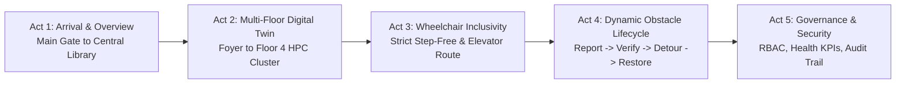

# PHASE 29 — FINAL DEMONSTRATION & VIVA PRESENTATION GUIDE
## Accessible Campus Navigator — JAIN Global Campus (Faculty of Engineering and Technology)

**Project:** Accessible Campus Navigator  
**Institution:** JAIN (Deemed-to-be University)  
**Lead Presenter:** Rudra Pratap (USN: 25)  
**Repository:** `https://github.com/rudrapratap17003-coder/Campus-navigation`  
**Application URL:** `http://localhost:8501`  
**Milestone:** Phase 29 — Final Demonstration Readiness  
**Target Audience:** Academic Evaluation Committee, External Examiners, University Dignitaries

---

## 1. DEMONSTRATION BRIEFING & ENVIRONMENT SETUP

### Quick Launch Instructions
1. Ensure the Python virtual environment is activated and the Streamlit daemon is running:
   ```powershell
   cd "C:\Users\rudra pratap\OneDrive\Documents\Campus navigation"
   & ".venv\Scripts\python.exe" -m streamlit run main.py --server.port 8501
   ```
2. Open any modern web browser (Google Chrome or Microsoft Edge recommended) to:
   **`http://localhost:8501`**
3. Verify that the server returns HTTP 200 and the dark-green campus dashboard loads cleanly.

### Pre-Seeded Demonstration Accounts

| Role | Username | Password | Intended Demonstration Scope |
|:---|:---|:---|:---|
| **Student** | `demo_student` | `DemoStudent2026!` | Basic campus navigation, destination search, wheelchair routing, reporting obstacles |
| **Field Staff** | `demo_staff` | `DemoStaff2026!` | Obstacle queue review, hazard verification, route blocking, obstacle resolution |
| **Administrator** | `demo_admin` | `DemoAdmin2026!` | Full governance, user role promotion/demotion, system health telemetry, immutable audit logs |

---

## 2. STEP-BY-STEP VIVA PRESENTATION SCRIPT (5-ACT SHOWCASE)



---

### ACT 1: THE FIRST-TIME VISITOR ARRIVAL (2–3 Minutes)
**Narrative:** *"Imagine a new student arriving at the JAIN Global Campus Main Gate on their first day of classes, needing to find the Central Library."*

1. **Navigate to the Navigation Page:** Click **"Navigation"** in the sidebar.
2. **Observe the Design System:** Point out the dark-green theme (`#07130F`), clean typography, and dataset toggle.
3. **Use Quick Suggestion Pills:**
   - Under the search bar, point to the suggestion pills: `HPC Lab`, `Library`, `Dean`, `Robotics`.
   - Click the **"Library"** pill. Notice how the destination selectbox instantly switches to the Central Library.
4. **Calculate Route:**
   - Set Start: `Main Campus Entrance Gate (OUT_GATE_MAIN)`.
   - Set Destination: `Central Library (FET_1F_LIBRARY)`.
   - Click **"Find Route"**.
5. **Highlight Key Deliverables:**
   - Distance: 185 meters, estimated walking time: 2.3 minutes.
   - Show the step-by-step turn guidance instructing the student to walk down the North Boulevard, enter the FET foyer, take the South Elevator to Floor 1, and proceed to the Library doors.
   - Switch to the **2D Campus Map** tab to show the smooth green vector path connecting the entrance gate to the academic building.

---

### ACT 2: MULTI-FLOOR 3D DIGITAL TWIN EXPLORATION (3 Minutes)
**Narrative:** *"Now let us observe an engineering student locating specialized research facilities on the upper levels of the 5-floor FET building."*

1. **Demonstrate Fast Search:**
   - Type `"HPC"` in the destination search field.
   - Show how the fuzzy autocomplete instantly identifies `FET_4F_HPC_CLUSTER` on Floor 4.
2. **Launch 3D Campus Map:** Click **"3D Campus Map"** in the sidebar.
3. **Showcase Architectural Geometry:**
   - Explain the 5-floor spatial digital twin built with Three.js.
   - Rotate, pan, and zoom into the model using the mouse.
   - Toggle individual floor visibility (Floor 0 through Floor 4) using the floor selector buttons.
4. **Multi-Level Route Visualization:**
   - Calculate route from Ground Foyer to HPC Cluster.
   - Show the green 3D glowing spline ascending through the transparent floor slabs, highlighting the elevator core and terminating directly at the 4th-floor HPC laboratory door.

---

### ACT 3: INCLUSIVE & WHEELCHAIR-ACCESSIBLE ROUTING (2–3 Minutes)
**Narrative:** *"Accessibility is not an afterthought in our system; it is a mathematical constraint enforced at the graph level."*

1. **Navigate to Navigation:**
   - Select Start: `Campus Auditorium (LOC_01)`.
   - Select Destination: `Department Head Office (LOC_12)`.
2. **Showcase Standard vs Wheelchair Routing:**
   - With wheelchair mode OFF: The standard shortest path directs the user up the central staircase (fastest path).
   - Toggle **"Wheelchair Accessible (Step-Free)"** ON:
   - Notice the route immediately recalculates: it completely bypasses the staircase and directs the user to the accessible elevator bank.
3. **Accessibility Metrics Card:**
   - Point out the **Overall Classification: Fully Accessible** badge (`#16A36A`).
   - Show the bottleneck analysis metrics confirming `has_stairs: False` and `has_elevator: True`.
4. **Demonstrate Graceful Fallback:**
   - Explain how the system handles scenarios where an elevator is out of service: rather than failing silently, it explicitly notifies the user with alternative assistance options.

---

### ACT 4: DYNAMIC OBSTACLE LIFECYCLE & LIVE DETOURS (3–4 Minutes)
**Narrative:** *"Campus environments are dynamic. Corridors get cleaned, construction happens, and pathways become temporarily blocked. Our system handles this in real time without human-reprogrammed maps."*

1. **Step 1: Student Reports Obstacle:**
   - Log in as `demo_student` / `DemoStudent2026!`.
   - Go to **"Obstacle Reports"** page.
   - Select Category: `Blocked pathway`, Severity: `High`.
   - Enter Description: *"Wet floor waxing and safety cones blocking the main corridor."*
   - Click **"Submit Obstacle Report"**.
   - Show that the report is in `Pending` state. Verify that the navigation route has **not** changed yet (preventing griefing or false reports).
2. **Step 2: Staff Verifies Hazard:**
   - Log out and log in as `demo_staff` / `DemoStaff2026!`.
   - Go to **"Obstacle Reports"**.
   - Locate the pending report and click **"Verify Hazard"**.
   - Status updates to `Verified` with timestamp and staff badge.
3. **Step 3: Observe Automatic Detour:**
   - Return to **"Navigation"** and recalculate the route across that corridor.
   - Show how the route finder dynamically avoids the blocked edge and routes around via the peripheral corridor.
4. **Step 4: Staff Resolves Hazard:**
   - Switch back to `demo_staff`.
   - Enter Resolution Notes: *"Floor dried; cones and barriers removed."*
   - Click **"Mark as Resolved"**.
   - Show that the path is restored and direct navigation is instantly re-enabled.

---

### ACT 5: GOVERNANCE, TELEMETRY & SECURITY CONTROLS (2 Minutes)
**Narrative:** *"Finally, let us inspect the administrative console that provides university officials with operational oversight and immutable audit security."*

1. **Log in as Administrator:** (`demo_admin` / `DemoAdmin2026!`).
2. **Access Governance Panel:** Click **"Admin Console"** in the sidebar.
3. **Demonstrate Key Capabilities:**
   - **User Directory:** View total registered accounts, roles, and status.
   - **Role Elevation:** Promote `demo_student` to `Field Staff`, then demonstrate how their permissions immediately update.
   - **Campus Health KPIs:** View total graph nodes (79), active pathways (106), active obstacles (0), and operational readiness (100%).
   - **Immutable Audit Trail:** Scroll down to the audit log table. Point out the chronological entries logging every login, role update, and obstacle resolution with timestamps and actor IDs.
   - **Security Protections:** Mention the sole-administrator demotion block, 600,000-iteration PBKDF2 hashing, and brute-force lockout.

---

## 3. ANTICIPATED VIVA QUESTIONS & TECHNICAL DEFENSE

### Q1: What graph data structure and algorithms are used for pathfinding?
**Answer:**  
*"We use NetworkX 3.x to model the campus as a weighted, directed multigraph. For pathfinding, we implement both Dijkstra's algorithm (using edge distance or estimated travel time as weights) and Breadth-First Search (BFS, for minimum hop counts). For wheelchair-accessible routes, our `AccessibilityEngine` constructs an edge-filtered subgraph by pruning any edges marked with stairs or steep gradients before running the pathfinding search, guaranteeing mathematical step-free compliance with time complexity $\mathcal{O}(E + V \log V)$."*

### Q2: How does the system handle multi-floor transitions in the 3D digital twin?
**Answer:**  
*"Each location in our graph has an explicit `(x, y, floor)` coordinate. Vertical transitions—such as elevators and staircases—are modeled as explicit directed edges connecting nodes with different `floor` values. In our Three.js engine, floor plates are spaced vertically along the Y-axis. When a route spans multiple floors, the engine generates a 3D Catmull-Rom spline that renders a vertical waypoint ascending through the elevator shaft, connecting the horizontal corridors seamlessly."*

### Q3: How do you prevent malicious or accidental disruption when students report obstacles?
**Answer:**  
*"We enforce strict Role-Based Access Control (RBAC). Students are permitted to submit reports, but submitted reports enter an inert `Pending` state. An unverified report has zero effect on the routing graph. Only authenticated `Field Staff` or `Administrators` can verify a report. Once verified, the `ObstacleManager` recalculates the active obstacle list and updates the NetworkX graph edge weights dynamically."*

### Q4: How is data protected against SQL injection and brute-force attacks?
**Answer:**  
*"First, 100% of our SQLite queries use parameterized prepared statements (`?` placeholders), completely eliminating SQL injection vectors. Second, password authentication utilizes PBKDF2-HMAC-SHA256 with 600,000 iterations and a cryptographically random 16-byte salt per user. Third, we enforce an automated sliding-window rate limiter: after 5 consecutive failed login attempts, the account is temporarily locked for 15 minutes, preventing automated dictionary or credential-stuffing attacks."*

### Q5: Can this system be deployed beyond SQLite to an enterprise cloud infrastructure?
**Answer:**  
*"Yes. In Phase 21, we developed a production-ready PostgreSQL migration exporter (`export_sqlite_to_postgres.py`) and containerized the entire stack using Docker and Nginx reverse proxy. The codebase cleanly decouples database operations into a centralized `DatabaseManager`, allowing drop-in connection pooling for PostgreSQL or AWS Aurora in multi-instance production environments."*

---

*Viva Presentation Guide Compiled by:*  
**Rudra Pratap** (USN: 25)  
Department of Computer Science & Engineering  
JAIN (Deemed-to-be University)  
November 2026
