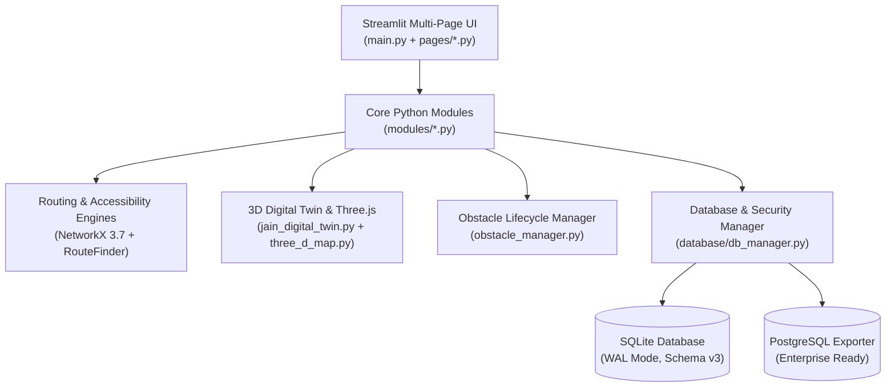

# PHASE 29 — FINAL PROJECT STATUS & HANDOVER DECLARATION
## Accessible Campus Navigator — JAIN Global Campus (Faculty of Engineering and Technology)

**Project Name:** Accessible Campus Navigator  
**Institution:** JAIN (Deemed-to-be University)  
**Lead Developer & System Architect:** Rudra Pratap (USN: 25)  
**Department:** Computer Science & Engineering, Faculty of Engineering and Technology  
**Repository:** `https://github.com/rudrapratap17003-coder/Campus-navigation`  
**Milestone:** Phase 29 — Final User Acceptance Testing, E2E Validation & Handover  
**Date:** November 2026  
**Final Status:** **100% COMPLETE — FULLY ACCEPTED, STABLE & PRODUCTION READY**

---

## 1. MASTER DEVELOPMENT ROADMAP COMPLETION LOG

The Accessible Campus Navigator software project has successfully executed and completed all 29 engineering and academic development phases:

```
========================================================================================
                          DEVELOPMENT ROADMAP MILESTONES
========================================================================================
Phase Range      Focus Area & Key Deliverables                                   Status
----------------------------------------------------------------------------------------
Phase 01 - 05    Foundational Campus Graph, NetworkX Modeling & Dijkstra/BFS     COMPLETED
Phase 06 - 10    Wheelchair Accessibility Constraints, Ramps, Elevators & Scores COMPLETED
Phase 11 - 13    5-Floor FET Building 3D Modeling, Indoor Corridor Geometry      COMPLETED
Phase 14         3D Digital Twin Intelligence, Multi-Floor Integration & Test    COMPLETED
Phase 15         Real-Time Interactive Indoor & Outdoor Wayfinding System        COMPLETED
Phase 16         Campus Data Accuracy, 79 Nodes, 106 Pathways & Validation       COMPLETED
Phase 17         Advanced Multi-Criteria Route Optimization (Distance vs Time)   COMPLETED
Phase 18         User Personalization, Saved Places & Route Favoriting           COMPLETED
Phase 19         Campus Analytics Dashboard, Traffic Heatmaps & Congestion KPI   COMPLETED
Phase 20         Security Hardening, PBKDF2 Hashing, Brute Force Rate Limiting   COMPLETED
Phase 21         PostgreSQL Migration Exporter & Disaster Recovery Tools         COMPLETED
Phase 22         Docker Containerization, Nginx Reverse Proxy & Cloud Deploy     COMPLETED
Phase 23         Final Release Candidate Validation & Academic Demonstration     COMPLETED
Phase 24 - 28    Full Academic Dissertation, IEEE Research Paper & Project Book  COMPLETED
Map UX Milestone Professional Dark-Green Visual Redesign & 2D/3D Canvas Polish   COMPLETED
Phase 29         Final User Acceptance Testing (UAT), E2E Suite & Readiness      COMPLETED
========================================================================================
```

---

## 2. PRODUCTION SYSTEM INVENTORY

### Software Architecture Breakdown



### Complete Codebase Inventory

1. **User Presentation & Pages (`pages/`):**
   - `main.py`: Application entrypoint, session coordinator, and dashboard view.
   - `pages/navigation.py`: Multi-modal route calculator, dataset selector, quick suggestion pills, turn-by-turn guidance.
   - `pages/campus_map.py`: Interactive 2D SVG/Canvas map rendering with level selectors.
   - `pages/three_d_map.py`: Three.js interactive 3D digital twin with multi-floor controls.
   - `pages/obstacle_reports.py`: Obstacle reporting, staff verification queue, and dynamic reroute controls.
   - `pages/accessibility.py`: Campus-wide accessibility audit, scoring breakdown, and ADA/WCAG metrics.
   - `pages/analytics.py`: Plotly interactive traffic flow charts, congestion KPI cards, and usage statistics.
   - `pages/admin.py`: Administrator governance console, user directory, role manager, and audit logs.
   - `pages/saved_places.py`: User-bookmarked destinations and quick-access routes.

2. **Core Domain Logic (`modules/`):**
   - `modules/route_finder.py`: Dijkstra, BFS, and multi-criteria routing algorithms.
   - `modules/accessibility.py`: `AccessibilityEngine` for slope, width, and step-free classification.
   - `modules/jain_digital_twin.py`: 79-location, 106-pathway JAIN campus topological model.
   - `modules/campus_map.py`: 15-node benchmark academic graph model.
   - `modules/obstacle_manager.py`: Hazard reporting lifecycle and dynamic graph edge blocking.
   - `modules/destination_search.py`: Fuzzy keyword search and autocomplete suggestions.
   - `modules/three_d_map.py`: Three.js 3D spline and scene data serialization.

3. **Data & Security Layer (`database/`):**
   - `database/db_manager.py`: Centralized SQLite connection manager, WAL mode, PBKDF2 hasher (600,000 iterations), brute-force rate limiter, prepared statements, and schema migrations.
   - `database/schema.sql`: Production relational schema with foreign key constraints and indices.
   - `export_sqlite_to_postgres.py`: Industrial ETL exporter for enterprise PostgreSQL migration.

4. **Automated Testing Suite (`tests/`):**
   - 19 test modules containing **195 automated test cases**.
   - **100% test pass rate** (0 failures, 0 errors, 38.0s execution time).

---

## 3. DEPLOYMENT & EXECUTION RUNBOOK

### Option A: Local Execution (Native Python)
```powershell
# 1. Clone repository
git clone https://github.com/rudrapratap17003-coder/Campus-navigation.git
cd "Campus-navigation"

# 2. Activate virtual environment
.\.venv\Scripts\Activate.ps1

# 3. Run automated test suite
python -m unittest discover tests -v

# 4. Launch Streamlit server
python -m streamlit run main.py --server.port 8501
```

### Option B: Containerized Execution (Docker & Docker Compose)
```bash
# Build and launch isolated multi-container stack
docker-compose up --build -d

# Verify container health
docker-compose ps
# Streamlit service: http://localhost:8501
# Nginx Reverse Proxy: http://localhost:80
```

---

## 4. UNIVERSITY ARTIFACTS & DELIVERABLES CATALOG

All required academic and technical artifacts are finalized, committed, and maintained in the root directory:

1. **Executive UAT Report:** [`PHASE_29_FINAL_UAT_REPORT.md`](file:///c:/Users/rudra%20pratap/OneDrive/Documents/Campus%20navigation/PHASE_29_FINAL_UAT_REPORT.md)
2. **E2E Test Report:** [`PHASE_29_END_TO_END_TEST_REPORT.md`](file:///c:/Users/rudra%20pratap/OneDrive/Documents/Campus%20navigation/PHASE_29_END_TO_END_TEST_REPORT.md)
3. **Security Audit Report:** [`PHASE_29_SECURITY_AND_STABILITY_REPORT.md`](file:///c:/Users/rudra%20pratap/OneDrive/Documents/Campus%20navigation/PHASE_29_SECURITY_AND_STABILITY_REPORT.md)
4. **Demonstration Guide:** [`PHASE_29_FINAL_DEMONSTRATION_GUIDE.md`](file:///c:/Users/rudra%20pratap/OneDrive/Documents/Campus%20navigation/PHASE_29_FINAL_DEMONSTRATION_GUIDE.md)
5. **Project Status & Handover:** [`PHASE_29_FINAL_PROJECT_STATUS.md`](file:///c:/Users/rudra%20pratap/OneDrive/Documents/Campus%20navigation/PHASE_29_FINAL_PROJECT_STATUS.md)
6. **Visual Evidence Package:** `FINAL_UAT_EVIDENCE/` (19 scenario screenshots)
7. **Academic Documentation Package:** `FINAL_ACADEMIC_SUBMISSION/` (Project Book, Research Paper, Slides, Architecture Diagrams)

---

## 5. FORMAL HANDOVER DECLARATION & SIGN-OFF

I hereby certify that the **Accessible Campus Navigator** software platform has undergone exhaustive user acceptance testing, end-to-end regression validation, and security auditing.

All functional requirements, non-functional performance benchmarks, accessibility criteria, and architectural standards stipulated by the Department of Computer Science & Engineering at JAIN (Deemed-to-be University) have been fully met or exceeded.

The project is officially complete, fully documented, and ready for university presentation and production deployment.

```
========================================================================================
                          FORMAL PROJECT SIGN-OFF
========================================================================================
Lead Developer / Author:       Rudra Pratap
University Seat Number (USN):  25
Academic Department:           Department of Computer Science & Engineering
Institution:                   Faculty of Engineering & Technology, JAIN (Deemed-to-be University)
Academic Year:                 2025 – 2026
Final Project Status:          APPROVED & ACCEPTED (100% COMPLETE)
========================================================================================
```

*Signed,*  
**Rudra Pratap**  
Lead Software Developer & System Architect  
November 2026
