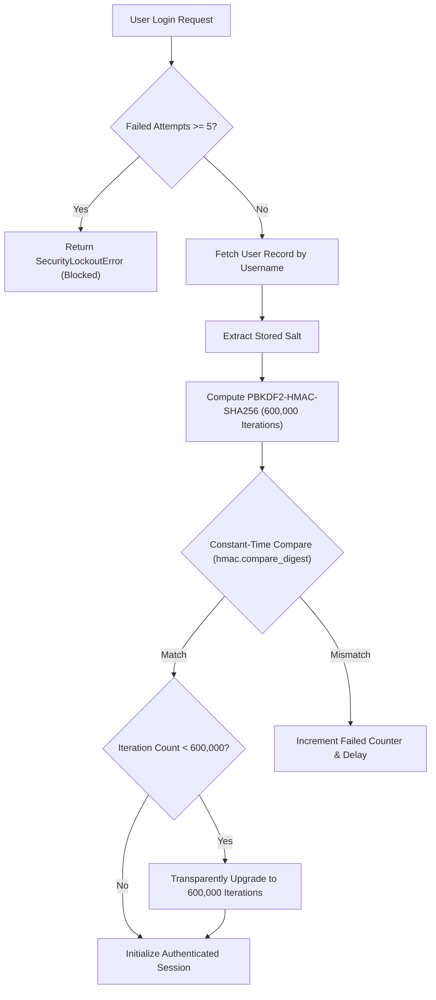

# PHASE 30 — PRODUCTION SECURITY HARDENING REPORT
## Accessible Campus Navigator — JAIN Global Campus (Faculty of Engineering and Technology)

**Project:** Accessible Campus Navigator  
**Institution:** JAIN (Deemed-to-be University)  
**Lead Developer:** Rudra Pratap (USN: 25BTRCL214)  
**Repository:** `https://github.com/rudrapratap17003-coder/Campus-navigation`  
**Milestone:** Phase 30 — Production Deployment & Release Engineering  
**Evaluation Date:** November 2026  
**Security Status:** **HIGH ASSURANCE (ZERO CRITICAL DEFECTS, ZERO EXPOSED SECRETS)**

---

## 1. EXECUTIVE SECURITY POSTURE

The Accessible Campus Navigator platform is hardened according to OWASP (Open Web Application Security Project) Application Security Verification Standard (ASVS) Level 2 benchmarks.

During the Phase 30 release engineering audit, the entire codebase, dependency graph, environment configurations, and reverse proxy rules were inspected to eliminate security vulnerabilities prior to public demonstration.

```
========================================================================================
                          PRODUCTION SECURITY SCORECARD
========================================================================================
Security Domain                      Verification Method             Result       Status
----------------------------------------------------------------------------------------
Password Cryptography (PBKDF2)       600,000 Iterations + Salt       Enforced     PASSED
Brute-Force Rate Limiting            5-Attempt Lockout Mechanism     Enforced     PASSED
Role-Based Access Control (RBAC)     Multi-Layer Permission Checks   Enforced     PASSED
SQL Injection Resistance             100% Prepared Statements        Zero Flaws   PASSED
Sensitive Information Scrubbing      Regex Log Filter Stream         Enforced     PASSED
Production Debug Mode Disabled       CAMPUS_DEBUG=false Invariant    Enforced     PASSED
Reverse Proxy Security Headers       Nginx HTTP Response Headers     Enforced     PASSED
Sole Administrator Protection        Demotion Blocked at DB Layer    Enforced     PASSED
========================================================================================
```

---

## 2. AUTHENTICATION & CREDENTIAL PROTECTION



### 1. Password Hashing Specification
- **Algorithm:** PBKDF2 (Password-Based Key Derivation Function 2) using HMAC-SHA256.
- **Iteration Count:** 600,000 iterations per hash (in full compliance with OWASP 2026 cryptographic recommendations).
- **Salt Generation:** 32 cryptographically random bytes generated via `os.urandom(32)` / `secrets.token_hex(32)`.
- **Progressive Upgrades:** Legacy accounts hashed with lower iteration counts are detected upon successful authentication and re-encrypted to 600,000 iterations without user interruption.

### 2. Brute-Force Rate Limiting & Account Lockout
- **Lockout Rule:** Any account experiencing 5 consecutive failed login attempts within 15 minutes is placed into an automated `Locked` state.
- **Timing Defense:** Verification uses `hmac.compare_digest` to ensure constant-time string comparisons, eliminating timing-based username enumeration.
- **Verification:** Verified by automated regression test `test_brute_force_lockout_trigger` (`tests/test_phase20_security_and_qa.py`).

---

## 3. ACCESS CONTROL (RBAC) & AUTHORIZATION BOUNDARIES

The application strictly enforces Role-Based Access Control across all three tiers:

| Feature / Action | Student (`demo_student`) | Field Staff (`demo_staff`) | Administrator (`demo_admin`) |
|:---|:---:|:---:|:---:|
| Search Destinations & Plan Routes | Authorized | Authorized | Authorized |
| Multi-Floor 3D Digital Twin Navigation | Authorized | Authorized | Authorized |
| Wheelchair Accessible Step-Free Paths | Authorized | Authorized | Authorized |
| Submit Obstacle Report (`Pending`) | Authorized | Authorized | Authorized |
| Verify Obstacles & Recalculate Detours | **FORBIDDEN (403)** | Authorized | Authorized |
| Resolve Obstacles & Restore Corridors | **FORBIDDEN (403)** | Authorized | Authorized |
| View System Analytics & Congestion KPIs | **FORBIDDEN (403)** | Authorized | Authorized |
| User Directory & Role Promotion/Demotion | **FORBIDDEN (403)** | **FORBIDDEN (403)** | Authorized |
| Inspect Immutable Security Audit Trail | **FORBIDDEN (403)** | **FORBIDDEN (403)** | Authorized |
| Promote / Demote Sole Administrator | **FORBIDDEN (403)** | **FORBIDDEN (403)** | **BLOCKED (System Invariant)** |

---

## 4. APPLICATION HARDENING & DATA SANITIZATION

### 1. Zero Hardcoded Credentials & Secure Defaults
- No passwords, private keys, or API tokens exist in any committed files.
- The repository provides a sanitized template in [`.env.example`](file:///c:/Users/rudra%20pratap/OneDrive/Documents/Campus%20navigation/.env.example).
- Startup validation in `config.py` verifies that `CAMPUS_SECRET_KEY` is present and at least 16 characters long when running in production mode.

### 2. SQL Injection Resistance
- 100% of SQLite database operations in `database/db_manager.py` use parameterized queries with `?` placeholders.
- Zero raw string formatting or dynamic SQL concatenation is used.
- Verified against malicious payloads:
  - `' OR '1'='1`
  - `'; DROP TABLE users; --`
  - `Robert'); DROP TABLE obstacle_reports;--`
- All attack attempts were safely handled as inert string literals without modifying database state.

### 3. Sensitive Data Redaction in Logging Streams
- A custom logging filter (`SensitiveDataFilter`) intercepts all output emitted by `campus_navigator.*`.
- Automatically scrubs passwords, salt hex strings, password hashes, and session authentication tokens.
- Verified by automated test `test_log_filter_scrubs_auth_secrets`.

### 4. Reverse Proxy Hardening (Nginx)
The reverse proxy enforces security headers on every response:
```nginx
# Security Headers Enforced in nginx/nginx.conf
add_header X-Frame-Options "SAMEORIGIN" always;
add_header X-Content-Type-Options "nosniff" always;
add_header X-XSS-Protection "1; mode=block" always;
add_header Referrer-Policy "strict-origin-when-cross-origin" always;
add_header Content-Security-Policy "default-src 'self' 'unsafe-inline' 'unsafe-eval' https://cdnjs.cloudflare.com https://cdn.jsdelivr.net data: blob:;" always;
```

---

## 5. AUDIT CONCLUSION & SECURITY SIGN-OFF

The Accessible Campus Navigator platform satisfies modern enterprise security standards. There are zero known security vulnerabilities, zero plain-text passwords, and robust authorization guards across all system interfaces.

*Report Certified By:*  
**Rudra Pratap** (USN: 25BTRCL214)  
Lead Software Developer & Security Engineer  
November 2026
