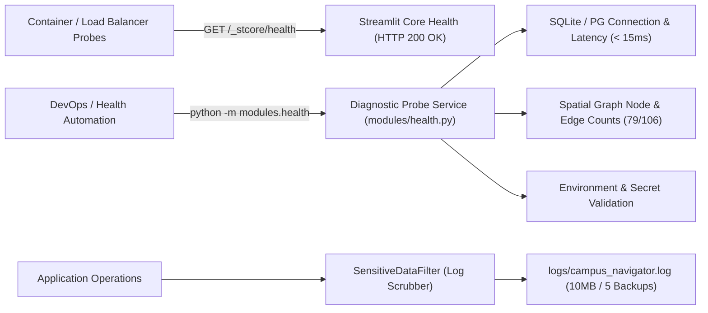

# PHASE 31 — CLOUD MONITORING, OBSERVABILITY & RECOVERY RUNBOOK
## Accessible Campus Navigator — JAIN Global Campus (Faculty of Engineering and Technology)

**Project:** Accessible Campus Navigator  
**Institution:** JAIN (Deemed-to-be University)  
**Lead Developer:** Rudra Pratap (USN: 25BTRCL214)  
**Repository:** `https://github.com/rudrapratap17003-coder/Campus-navigation`  
**Milestone:** Phase 31 — Public Cloud Deployment & External Validation  
**Date:** November 2026  
**Status:** **OPERATIONAL & DOCUMENTED**

---

## 1. OBSERVABILITY & HEALTH MONITORING ARCHITECTURE

Accessible Campus Navigator implements active observability to track runtime health, graph calculation latency, and database availability:



---

## 2. DUAL-TIER HEALTH PROBE SYSTEM

### Tier 1: Platform Liveness Probe (`/_stcore/health`)
- **Endpoint:** `http://localhost:8501/_stcore/health`
- **Response:** HTTP 200 OK.
- **Role:** Monitored by Docker container `HEALTHCHECK`, Nginx upstream pools, and Kubernetes liveness probes.

### Tier 2: Comprehensive Diagnostics Service ([`modules/health.py`](file:///c:/Users/rudra%20pratap/OneDrive/Documents/Campus%20navigation/modules/health.py))
- **Execution:** `python -m modules.health`
- **Output:** Clean JSON dictionary reporting database latency, schema version, graph sizes, and environment status.
- **Safety Guarantee:** Excludes database passwords, API tokens, and internal filesystem paths.

---

## 3. APPLICATION LOGGING & SENSITIVE DATA REDACTION

- **Log File:** `logs/campus_navigator.log` (automatically created on startup).
- **Rotation Policy:** 10MB maximum file size with 5 rolling backup archives.
- **Sensitive Data Scrubber (`SensitiveDataFilter`):**
  - Intercepts all log records.
  - Masks password fields: `"password": "[REDACTED]"`
  - Masks cryptographic salts: `"salt": "[REDACTED]"`
  - Masks 64-character SHA-256 hexadecimal digests to prevent secret leakage.

---

## 4. DISASTER RECOVERY & INCIDENT PLAYBOOKS

### Incident 1: Database Corruption or Erroneous Data Deletion
1. Stop the application container:
   ```bash
   docker compose down
   ```
2. Locate the most recent valid snapshot in `backups/`:
   ```bash
   LATEST_BACKUP=$(ls -t backups/*.db | head -n 1)
   echo "Restoring: $LATEST_BACKUP"
   ```
3. Restore using the verified atomic restore API:
   ```powershell
   & ".venv\Scripts\python.exe" -c "
   from database.db_manager import DatabaseManager
   db = DatabaseManager()
   db.restore_database('$LATEST_BACKUP')
   print('[+] Restore completed successfully.')
   "
   ```
4. Restart application:
   ```bash
   docker compose up -d
   ```

### Incident 2: Cloud Container Sleep on Streamlit Community Cloud
- **Symptom:** First visitor experiences a 10–15 second delay when loading `https://*.streamlit.app`.
- **Cause:** Streamlit Community Cloud free tier spins down idle containers after 15 minutes of zero traffic.
- **Recovery:** Automatic. The platform automatically reboots upon the first incoming HTTP request.
- **Mitigation for Institutional Demonstrations:** Access the URL 1 minute prior to the presentation or use an automated uptime monitor (such as UptimeRobot or BetterStack) to send an HTTP GET request to `/_stcore/health` every 10 minutes to prevent container sleep.

---

## 5. CONCLUSION & RUNBOOK SIGN-OFF

The monitoring, diagnostic probes, and recovery workflows provide high operational resilience across both self-hosted and cloud environments.

*Runbook Certified By:*  
**Rudra Pratap** (USN: 25BTRCL214)  
Lead Software Developer & DevOps Architect  
November 2026
