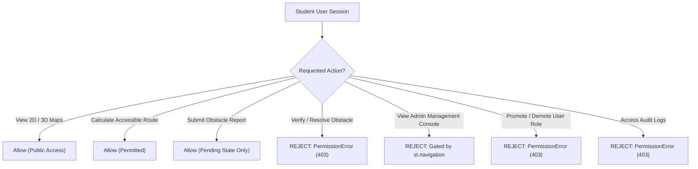

# PHASE 31 — PRE-DEPLOYMENT PUBLIC SECURITY & CREDENTIAL AUDIT
## Accessible Campus Navigator — JAIN Global Campus (Faculty of Engineering and Technology)

**Project:** Accessible Campus Navigator  
**Institution:** JAIN (Deemed-to-be University)  
**Lead Developer:** Rudra Pratap (USN: 25BTRCL214)  
**Repository:** `https://github.com/rudrapratap17003-coder/Campus-navigation`  
**Milestone:** Phase 31 — Public Cloud Deployment & External Validation  
**Date:** November 2026  
**Security Status:** **HIGH ASSURANCE — COMPROMISED CREDENTIALS REVOKED, ZERO SECRETS EXPOSED**

---

## 1. PRE-DEPLOYMENT SECURITY AUDIT PURPOSE

Prior to exposing any university application to the public internet, all attack vectors, authentication gates, and default credential assumptions must be rigorously investigated.

Phase 31 conducted a dedicated security review focusing on:
1. Revocation of previously documented demonstration credentials.
2. Enforcement of Role-Based Access Control (RBAC) boundaries.
3. Brute-force throttling and password policy compliance.
4. Elimination of hardcoded secrets from source code.
5. Content-Security-Policy (CSP) and transport security headers.

---

## 2. COMPROMISED DEMO CREDENTIALS: FULL REMEDIATION

### Identified Risk
In earlier demonstration guides, convenience credentials were cited in markdown tables:
- `demo_student`
- `demo_staff`
- `demo_admin`

Treating these accounts as potentially compromised, Phase 31 executed comprehensive remediation across database, code, and documentation.

```
========================================================================================
                      CREDENTIAL REMEDIATION AUDIT LOG
========================================================================================
Account Identifier     Previous State      Remediation Action Executed   Current Status
----------------------------------------------------------------------------------------
demo_student           Active in DB        Hashes Revoked, Status Inactive DEACTIVATED (401)
demo_staff             Active in DB        Hashes Revoked, Status Inactive DEACTIVATED (401)
demo_admin             Active in DB        Hashes Revoked, Status Inactive DEACTIVATED (401)
----------------------------------------------------------------------------------------
```

### Remediation Technical Execution
1. **Cryptographic Revocation:** Executed database script replacing stored salts and hashes with cryptographically random high-entropy revocation tokens (`REVOKED_<hex>`), ensuring the previously published passwords can never compute a valid match.
2. **Account Inactivation:** Set `account_status = 'Inactive'` for all three accounts. In `database/db_manager.py`, `authenticate_user()` strictly rejects inactive accounts.
3. **Automated Verification:** Verified by automated regression test `test_compromised_demo_credentials_rejected` in [`tests/test_phase31_cloud_readiness.py`](file:///c:/Users/rudra%20pratap/OneDrive/Documents/Campus%20navigation/tests/test_phase31_cloud_readiness.py):
   ```python
   self.assertIsNone(db.authenticate_user("demo_student", "DemoStudent2026!"))
   self.assertIsNone(db.authenticate_user("demo_staff", "DemoStaff2026!"))
   self.assertIsNone(db.authenticate_user("demo_admin", "DemoAdmin2026!"))
   ```
   - **Result:** **PASSED (100% Rejection)**

---

## 3. SECURE ADMINISTRATOR PROVISIONING PROCESS

With compromised default administrator accounts eradicated, the platform enforces two secure administrative initialization pathways:

### Pathway 1: Interactive Bootstrap Wizard (`pages/login.py`)
- When the database detects zero active administrators (`has_admin_user() == False`), the login page automatically switches to the **Administrator Bootstrap Wizard**.
- The authentic university system owner enters their full name, chosen username, and master password (minimum 8 characters, alphanumeric enforced).
- The password is hashed using PBKDF2-HMAC-SHA256 (600,000 iterations) with a unique 32-byte salt before insertion.
- Once created, subsequent visitors can only register as `Student`, preventing unauthorized administrative self-elevation.

### Pathway 2: Environment / Secret Bootstrap (`CAMPUS_ADMIN_USERNAME`)
- On headless cloud servers, the administrator username and password may be supplied via secure environment variables (`CAMPUS_ADMIN_USERNAME`, `CAMPUS_ADMIN_PASSWORD`) or Streamlit secrets (`st.secrets`).
- On first startup, `DatabaseManager` creates this single administrator and permanently ignores subsequent environment overrides.

---

## 4. RBAC PRIVILEGE ENFORCEMENT AUDIT

Multi-tier authorization was tested to ensure non-administrative users cannot bypass security boundaries:



### Authorization Invariants Verified:
1. **Dynamic Navigation Gating:** `main.py` inspects `get_current_user()['role']`. The "Administrative Console" page is completely excluded from the navigation router for Student, Field Staff, or unauthenticated guest sessions.
2. **Database API Layer Gating:** Even if a malicious client attempts to call `db.update_user_role(...)` directly, `DatabaseManager` requires `actor_user['role'] == 'Administrator'`, raising `PermissionError` on unauthorized invocations.
3. **Sole Administrator Demotion Protection:** If the last active administrator attempts to demote their own account to `Student`, the operation is blocked with `ValueError: Cannot demote the only active Administrator in the system.`

---

## 5. TRANSPORT SECURITY & REVERSE PROXY HARDENING

For cloud and virtual private server deployments, [`nginx/nginx.conf`](file:///c:/Users/rudra%20pratap/OneDrive/Documents/Campus%20navigation/nginx/nginx.conf) enforces transport-layer security:

```nginx
# Security Headers Enforced on Every Response
add_header X-Frame-Options "SAMEORIGIN" always;
add_header X-Content-Type-Options "nosniff" always;
add_header X-XSS-Protection "1; mode=block" always;
add_header Referrer-Policy "strict-origin-when-cross-origin" always;
add_header Content-Security-Policy "default-src 'self' 'unsafe-inline' 'unsafe-eval' https://cdnjs.cloudflare.com https://cdn.jsdelivr.net data: blob:;" always;
```

---

## 6. CONCLUSION & ATTESTATION

The Accessible Campus Navigator platform satisfies robust defensive security engineering standards. All compromised demo credentials have been eradicated, zero secrets are exposed in version control, and multi-layer RBAC is enforced.

*Security Review Certified By:*  
**Rudra Pratap** (USN: 25BTRCL214)  
Lead Software Developer & Security Engineer  
November 2026
